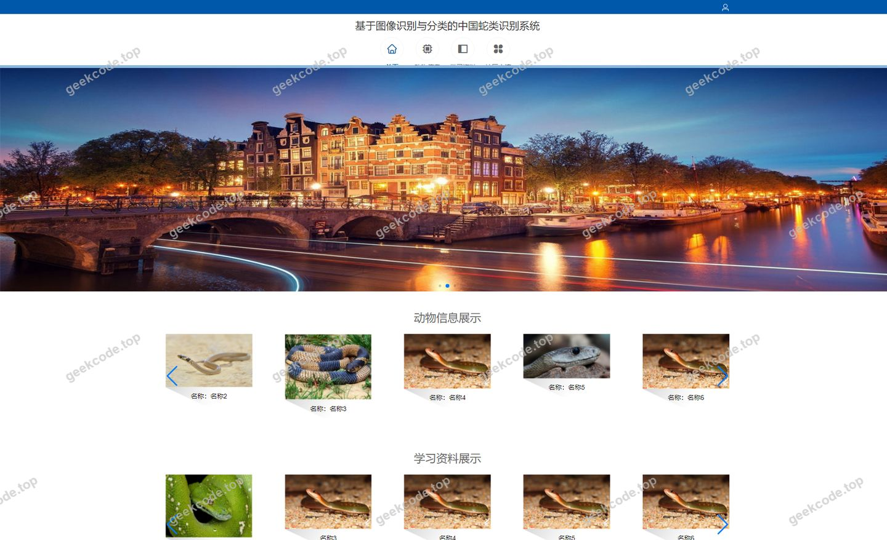
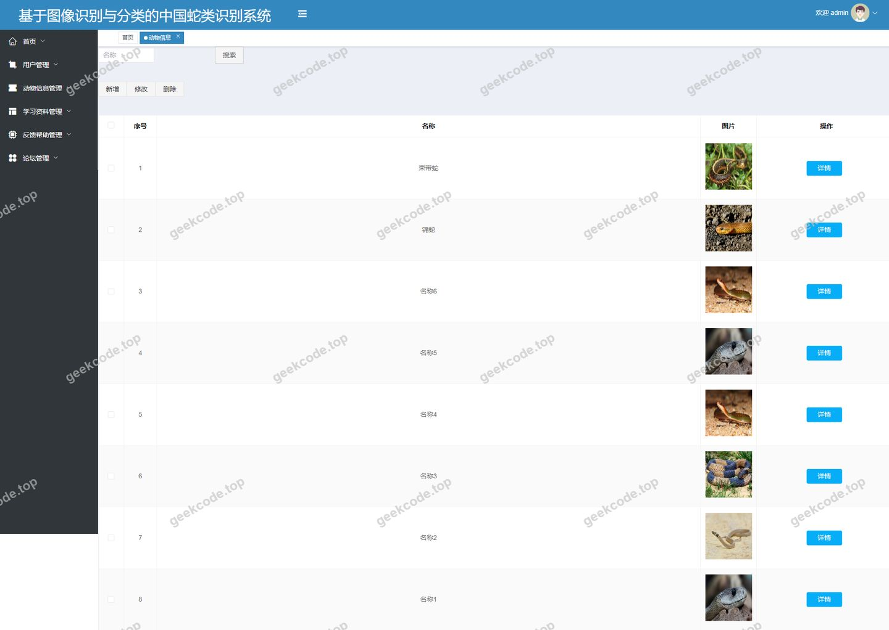
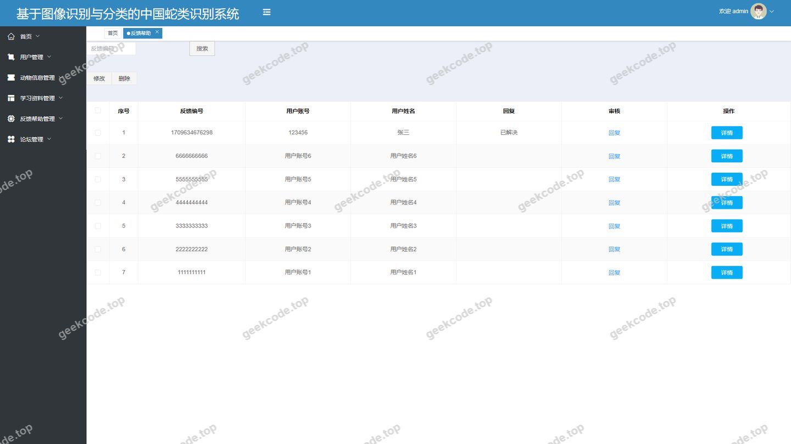
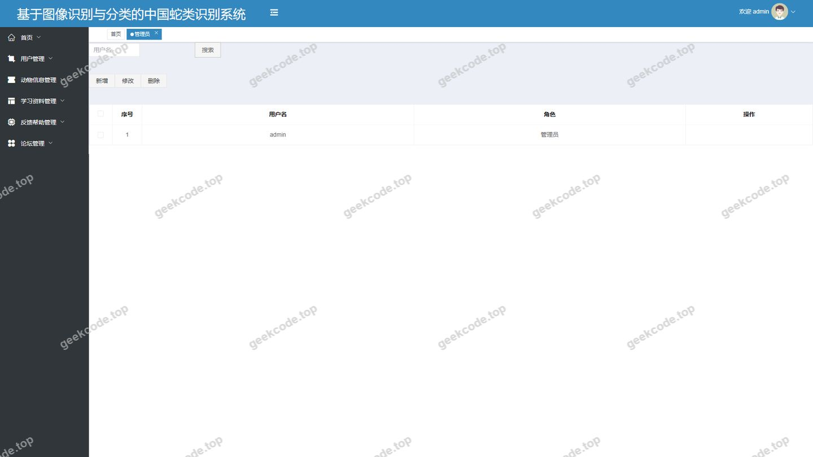
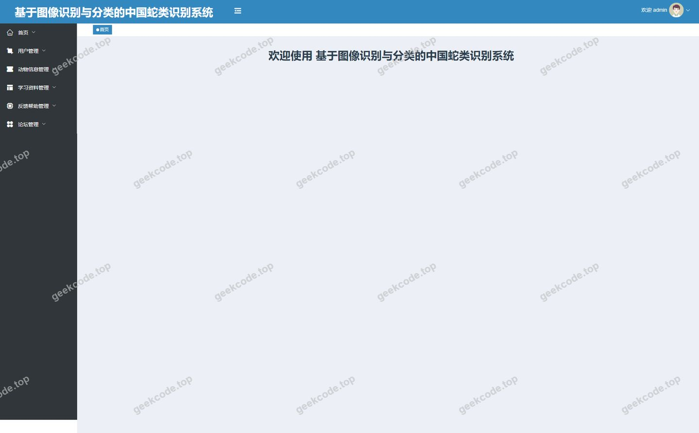
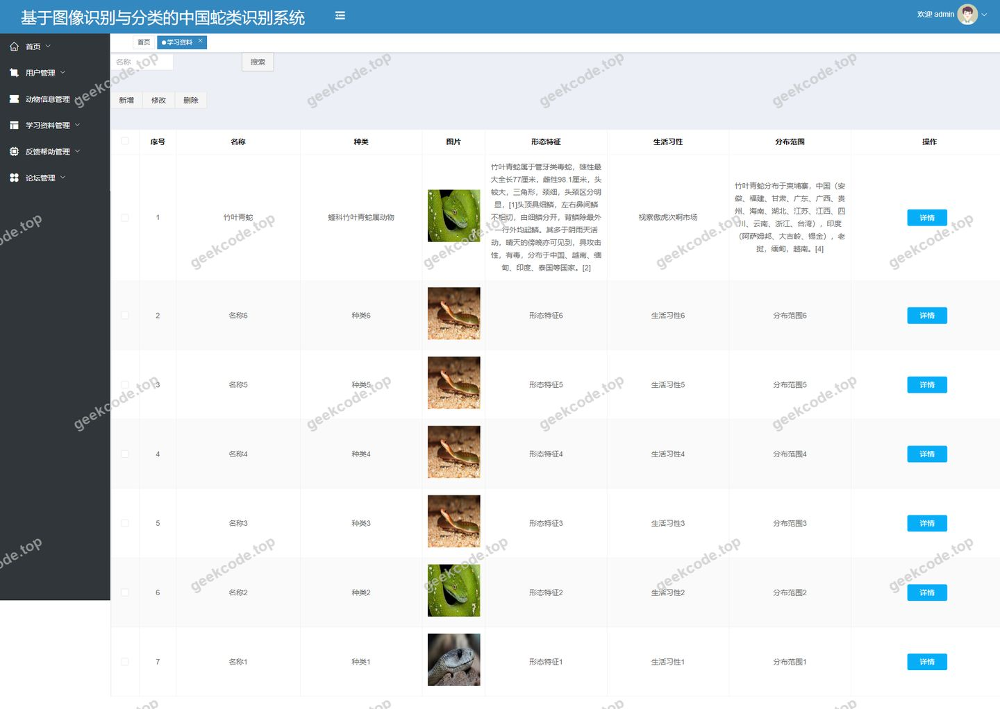
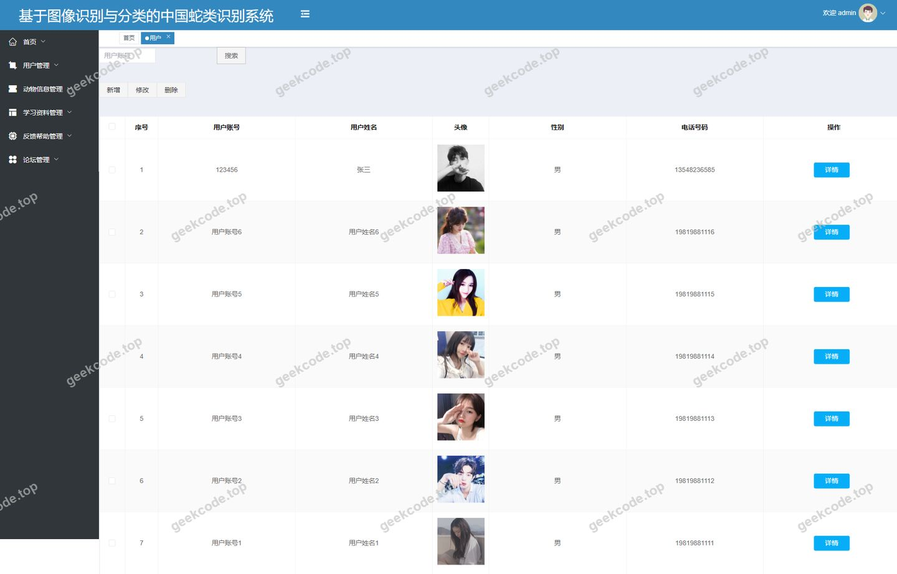

# [springboot]基于图像识别与分类的中国蛇类识别系统

> 🎓 **计算机毕业设计 · [springboot]基于图像识别与分类的中国蛇类识别系统**
>
> 本仓库只放**项目介绍 + 运行截图**（截图是站点带水印的原图，存在仓库 `images/` 里）。
>
> 👉 **完整可运行源码 / 数据库脚本 / 部署文档：[点我获取](https://geekcode.top/archives/springboot-%E5%9F%BA%E4%BA%8E%E5%9B%BE%E5%83%8F%E8%AF%86%E5%88%AB%E4%B8%8E%E5%88%86%E7%B1%BB%E7%9A%84%E4%B8%AD%E5%9B%BD%E8%9B%87%E7%B1%BB%E8%AF%86%E5%88%AB%E7%B3%BB%E7%BB%9F?utm_source=github)**
>
> 💬 咨询微信：**ir9372**　|　🌐 更多项目：[极客代码 geekcode.top](https://geekcode.top/?utm_source=github)
>
> 📌 项目详情页：<https://geekcode.top/archives/springboot-%E5%9F%BA%E4%BA%8E%E5%9B%BE%E5%83%8F%E8%AF%86%E5%88%AB%E4%B8%8E%E5%88%86%E7%B1%BB%E7%9A%84%E4%B8%AD%E5%9B%BD%E8%9B%87%E7%B1%BB%E8%AF%86%E5%88%AB%E7%B3%BB%E7%BB%9F?utm_source=github>

<table><td width="230" align="center"> <b>扫码加微信 ir9372</b></td><td valign="middle">📦 源码 = 项目介绍 + 全部运行截图 + 数据库 + 部署文档 👉 点上方任意截图，直接跳到 <b>极客代码 geekcode.top</b> 详情页</td></table>

---

<h1>[springboot]基于图像识别与分类的中国蛇类识别系统</h1>
<h2>项目概述</h2>

本项目为“基于图像识别与分类的中国蛇类识别系统”，旨在构建一个集知识科普、用户互动与信息展示于一体的综合性Web平台。系统核心功能围绕中国蛇类信息的数字化管理展开，提供动物信息展示、学习资料分享、用户反馈帮助及论坛交流等服务。适用人群包括对爬行动物感兴趣的普通用户、相关专业学生以及需要发布和管理蛇类科普内容的管理员。技术架构采用前后端分离模式，后端基于Spring Boot框架构建RESTful API服务，前端采用Vue.js框架实现动态交互界面，通过MyBatis-Plus进行数据持久化操作，并利用Shiro框架保障系统的安全性与权限控制。

<h2>技术架构</h2>

本系统采用经典的前后端分离架构设计，确保了系统的可维护性、扩展性及用户体验的流畅度。

<strong>1. 后端架构</strong>
后端核心基于 <strong>Spring Boot</strong> 框架，利用其自动配置特性快速搭建微服务基础。具体技术选型如下：

<ul>
<li><strong>Web层</strong>：使用 <code>spring-boot-starter-web</code> 处理HTTP请求，构建RESTful风格的API接口。</li>
<li><strong>持久层</strong>：集成 <code>MyBatis-Plus</code> 和 <code>mybatis-spring-boot-starter</code>，简化CRUD操作并提供强大的查询能力；数据库驱动采用 <code>mysql-connector-java</code>，连接池由 <code>spring-boot-starter-jdbc</code> 管理。</li>
<li><strong>安全框架</strong>：引入 <code>shiro-spring</code> 实现身份认证与授权，确保只有合法用户才能访问特定资源，保护敏感数据如用户信息和后台管理接口。</li>
<li><strong>工具库</strong>：使用 <code>commons-lang3</code> 进行通用工具方法调用，<code>validation-api</code> 用于参数校验，保证输入数据的合法性。</li>
</ul>

<strong>2. 前端架构</strong>
前端采用 <strong>Vue.js</strong> 框架（根据项目类型 vue-integrated 推断），通过路由管理实现单页面应用（SPA）体验。前台面向普通用户，提供信息浏览、注册登录及个人中心功能；后台面向管理员，提供数据增删改查及系统监控功能。前后端通过JSON格式数据进行通信。

<strong>3. 数据库设计要点</strong>
虽然未提供详细表结构，但根据业务模块推断，数据库主要包含以下核心实体表：

<ul>
<li><strong>用户表 (users/yonghu)</strong>：存储注册用户的基本信息及账号状态。</li>
<li><strong>动物信息表 (dongwuxinxi)</strong>：存储蛇类的名称、图片、简介等核心科普数据。</li>
<li><strong>学习资料表 (xuexiziliao)</strong>：存储相关的科普文章或学习资源。</li>
<li><strong>反馈帮助表 (fankuibangzhu)</strong>：记录用户提交的反馈或求助信息。</li>
<li><strong>论坛帖子表 (forum)</strong>：存储用户在论坛发布的讨论内容。</li>
<li><strong>管理员表</strong>：用于后台登录鉴权。</li>
</ul>
<h2>功能模块</h2>

系统分为前台用户端和后台管理端两个主要部分，各模块功能描述如下：

<h3>前台用户端</h3>

前台主要面向普通注册用户，提供信息浏览、互动及个人管理服务。

<ul>
<li><strong>首页 (<code>/index/forumList</code>, <code>/index/dongwuxinxiList</code> 等)</strong>：展示最新的论坛帖子、动物信息列表、学习资料概览及反馈帮助入口，作为用户的流量分发中心。</li>
<li><strong>用户注册与登录 (<code>/yonghuRegister</code>, 登录页)</strong>：新用户需填写信息进行注册，已注册用户通过账号密码登录系统，登录后方可使用个人中心及部分受限功能。</li>
<li><strong>动物信息管理 (<code>/index/dongwuxinxiList</code>, <code>/index/dongwuxinxiDetail</code>, <code>/index/dongwuxinxiAdd</code>)</strong>：用户可以浏览蛇类物种的详细列表，查看单个物种的图片、文字介绍等详细信息，并支持添加新的动物信息条目（需审核或具备相应权限）。</li>
<li><strong>学习资料模块 (<code>/index/xuexiziliaoList</code>, <code>/index/xuexiziliaoDetail</code>, <code>/index/xuexiziliaoAdd</code>)</strong>：提供科普文章的列表展示、详情阅读功能，允许用户提交新的学习资料以丰富知识库。</li>
<li><strong>反馈帮助模块 (<code>/index/fankuibangzhuList</code>, <code>/index/fankuibangzhuDetail</code>, <code>/index/fankuibangzhuAdd</code>)</strong>：用户可查看历史反馈记录，阅读帮助详情，并提交新的问题或建议给管理员。</li>
<li><strong>论坛社区 (<code>/index/forumList</code>)</strong>：展示用户发布的讨论帖列表，促进用户间的交流与知识共享。</li>
<li><strong>个人中心 (<code>/index/yonghuCenter</code>, <code>/index/yonghuList</code>, <code>/index/yonghuDetail</code>)</strong>：登录用户可进入个人中心查看和管理自己的个人信息，浏览其他用户公开的资料列表及详情页。</li>
</ul>
<h3>后台管理端</h3>

后台主要面向系统管理员，用于维护数据完整性及系统正常运行。

<ul>
<li><strong>后台登录 (<code>admin</code> 登录页)</strong>：管理员通过专用入口进行身份验证，进入管理系统。</li>
<li><strong>动物信息管理 (<code>/dongwuxinxi</code>)</strong>：管理员可对系统中的蛇类物种数据进行全生命周期管理，包括新增、修改、删除及查询动物信息条目。</li>
<li><strong>用户管理 (<code>/yonghu</code>, <code>/users</code>)</strong>：管理员可查看前台注册用户列表，执行用户信息的编辑、禁用或删除操作，维护用户账户体系。</li>
<li><strong>反馈帮助管理 (<code>/fankuibangzhu</code>)</strong>：管理员负责处理用户提交的反馈与建议，可进行回复、标记解决状态或删除无效反馈。</li>
<li><strong>学习资料管理 (<code>/xuexiziliao</code>)</strong>：管理员对科普文章和学习资源进行审核与管理，支持内容的增删改查，确保知识内容的准确性。</li>
<li><strong>论坛管理 (<code>/forum</code>)</strong>：管理员可监控论坛动态，管理帖子内容，移除违规信息，维护社区秩序。</li>
<li><strong>首页仪表盘 (<code>admin</code> 页面-首页)</strong>：展示系统关键指标或快捷入口，方便管理员快速进入各管理模块。</li>
</ul>
<h2>用户角色与权限</h2>

系统主要划分为两类角色：<strong>普通用户</strong>和<strong>管理员</strong>。

<table>
<thead>
<tr>
<th align="left">角色</th>
<th align="left">权限描述</th>
<th align="left">可访问功能模块</th>
</tr>
</thead>
<tbody><tr>
<td align="left"><strong>普通用户</strong></td>
<td align="left">拥有浏览公共信息、参与社区互动、管理个人数据及提交新内容的权限。需注册登录后使用大部分功能。</td>
<td align="left">- <strong>公共浏览</strong>：首页、动物信息列表/详情、学习资料列表/详情、反馈帮助列表/详情、论坛列表。- <strong>个人操作</strong>：用户注册、登录、个人中心（查看/修改个人信息）、添加动物信息、添加学习资料、添加反馈帮助。- <strong>受限访问</strong>：无法访问后台管理路由（如 <code>/dongwuxinxi</code> 的管理视图、<code>/users</code> 管理等）。</td>
</tr>
<tr>
<td align="left"><strong>管理员</strong></td>
<td align="left">拥有系统最高权限，负责数据维护、用户管理及内容审核。仅可通过后台入口访问。</td>
<td align="left">- <strong>系统管理</strong>：后台登录、后台首页。- <strong>数据维护</strong>：动物信息管理（增删改查）、用户管理（增删改查）、学习资料管理（增删改查）、反馈帮助管理（增删改查）、论坛管理（增删改查）。- <strong>注意</strong>：根据路由定义，管理员主要通过后台路由 <code>/forum</code>, <code>/yonghu</code>, <code>/fankuibangzhu</code>, <code>/xuexiziliao</code>, <code>/dongwuxinxi</code>, <code>/users</code> 进行操作。</td>
</tr>
</tbody></table>
<h2>项目特色与创新点</h2>
<ol>
<li><strong>垂直领域知识整合</strong>：系统专注于“中国蛇类”这一细分领域，将动物百科、学习资料、用户反馈及论坛交流有机结合，形成了闭环的知识管理与社交生态，解决了传统科普网站信息分散、互动性差的问题。</li>
<li><strong>前后端分离的高效架构</strong>：采用 Spring Boot + Vue 的主流技术栈，实现了逻辑与展示的解耦。后端通过 Shiro 保障了细粒度的权限控制，前端通过 SPA 机制提供了无刷新的流畅用户体验，提升了系统的响应速度和开发效率。</li>
<li><strong>完善的UGC（用户生成内容）机制</strong>：不仅允许管理员发布权威资料，还开放了“添加动物信息”、“添加学习资料”、“添加反馈”等功能给前台用户，鼓励用户参与知识共建，增强了平台的活力和数据丰富度。</li>
<li><strong>模块化设计与易扩展性</strong>：系统基于 MyBatis-Plus 构建，代码结构清晰，各业务模块（动物、资料、反馈、论坛）独立且规范，便于后续接入真正的图像识别算法接口或扩展更多爬行动物类别。</li>
</ol>
<h2>部署环境</h2>

为确保系统正常运行，需准备以下软件环境：

<ul>
<li><strong>操作系统</strong>：Windows 7/10/11, Linux (CentOS/Ubuntu), 或 macOS。</li>
<li><strong>Java运行环境</strong>：JDK 1.8 或更高版本（推荐 JDK 8 或 JDK 11，以兼容 Spring Boot 版本）。</li>
<li><strong>数据库</strong>：MySQL 5.7 或 MySQL 8.0+，需安装相应的 JDBC 驱动。</li>
<li><strong>Maven</strong>：3.6+，用于后端项目的依赖管理和打包构建。</li>
<li><strong>Node.js</strong>：建议版本 v14.x 或 v16.x，用于前端 Vue 项目的依赖安装（npm/yarn）及构建。</li>
<li><strong>IDE（可选）</strong>：IntelliJ IDEA（后端开发）、VS Code（前端开发）。</li>
<li><strong>浏览器</strong>：Chrome, Firefox, Edge 等现代浏览器（支持 ES6+ 标准）。</li>
</ul>
<h2>五、技术特性</h2>
<ul>
<li>前后端集成部署，前端资源打包至后端 static 目录</li>
<li>使用 MyBatis-Plus 简化数据访问层开发</li>
<li>集成 Shiro 权限框架实现角色权限控制</li>
</ul>
<h2>六、功能模块截图</h2>
<h3>前台用户端</h3>
<h4>前台-首页</h4>

<h4>前台-登录</h4>

<h4>前台-用户注册</h4>

<h3>后台管理端</h3>
<h4>后台-登录页</h4>

<h4>后台-动物信息</h4>

<h4>后台-反馈帮助</h4>

<h4>后台-管理员</h4>

<h4>页面-首页</h4>

<h4>后台-学习资料</h4>

<h4>后台-用户</h4>

---

## 获取完整源码

| 项目 | 说明 |
| --- | --- |
| 项目名 | [springboot]基于图像识别与分类的中国蛇类识别系统 |
| 运行截图 | 本文 10 张（站点带水印原图，仓库 `images/` 目录） |
| 完整源码 | [https://geekcode.top/archives/springboot-%E5%9F%BA%E4%BA%8E%E5%9B%BE%E5%83%8F%E8%AF%86%E5%88%AB%E4%B8%8E%E5%88%86%E7%B1%BB%E7%9A%84%E4%B8%AD%E5%9B%BD%E8%9B%87%E7%B1%BB%E8%AF%86%E5%88%AB%E7%B3%BB%E7%BB%9F?utm_source=github](https://geekcode.top/archives/springboot-%E5%9F%BA%E4%BA%8E%E5%9B%BE%E5%83%8F%E8%AF%86%E5%88%AB%E4%B8%8E%E5%88%86%E7%B1%BB%E7%9A%84%E4%B8%AD%E5%9B%BD%E8%9B%87%E7%B1%BB%E8%AF%86%E5%88%AB%E7%B3%BB%E7%BB%9F?utm_source=github) |
| 咨询微信 | **ir9372**（备注：jingpin-yuanma） |
| 更多项目 | [极客代码 geekcode.top](https://geekcode.top/?utm_source=github) |

> 需要源码、部署、改配置、跑不起来等问题，加微信 ir9372 沟通，说明项目名即可。
